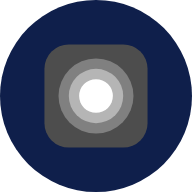
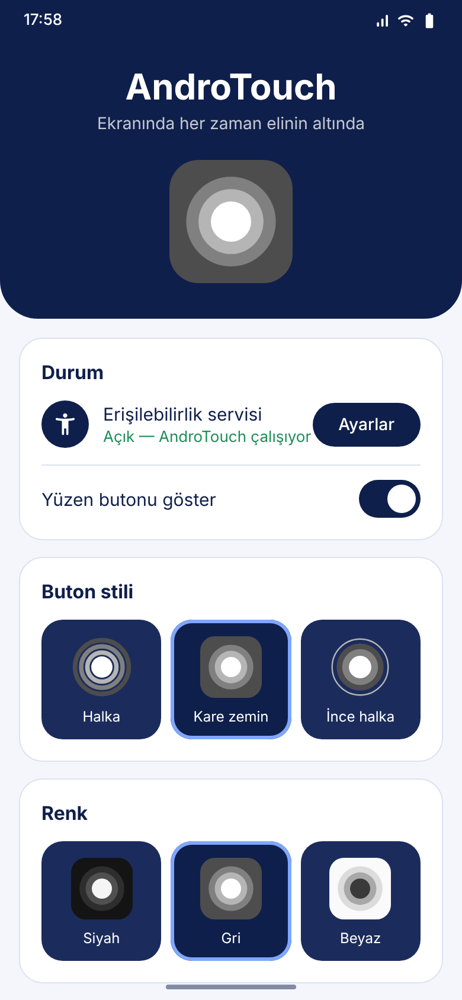
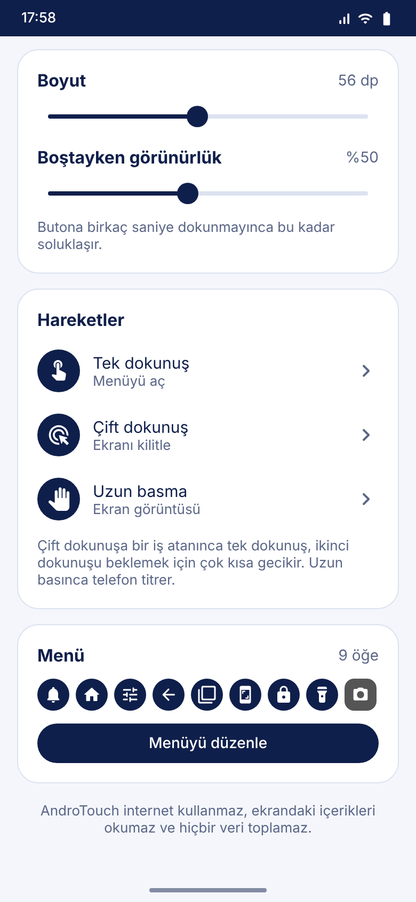
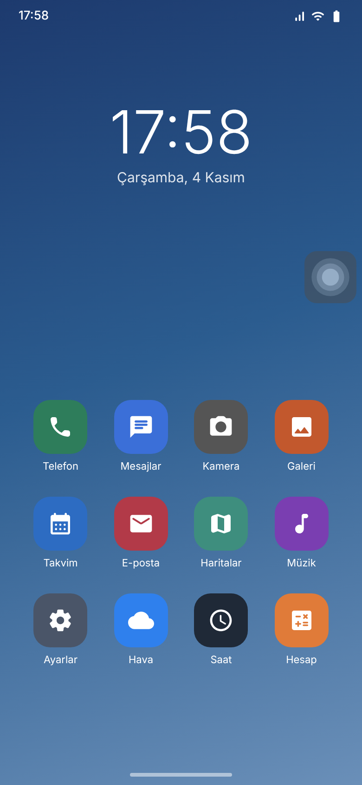
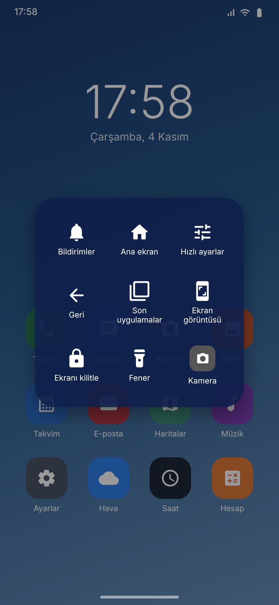
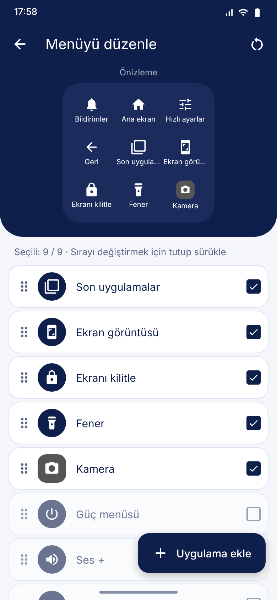
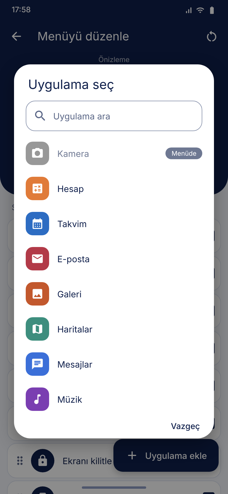
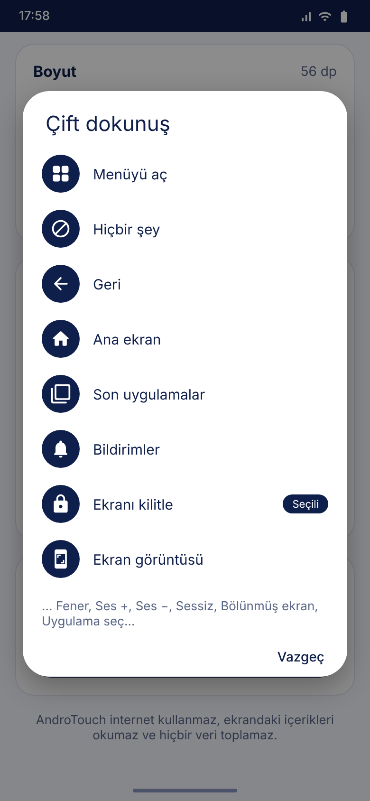
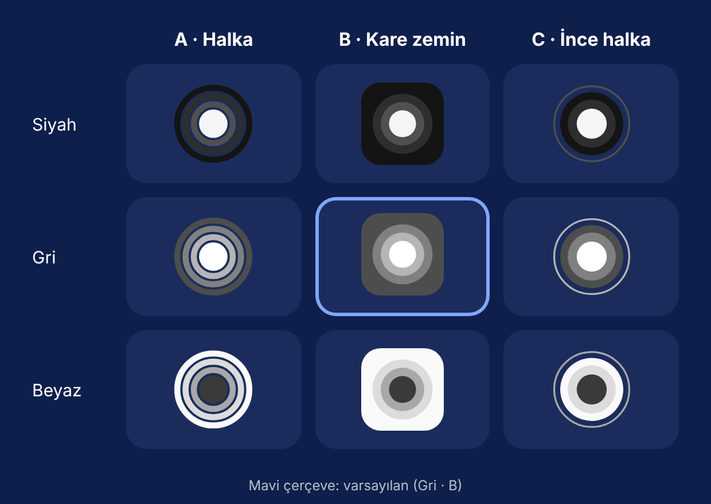

<div align="center">



# AndroTouch

**Android için yüzen asistan butonu — iPhone'daki AssistiveTouch'ın Android hali.**

Ekranın kenarında duran tek bir butonla geri, ana ekran, kilit, ekran görüntüsü, fener ve telefonundaki istediğin uygulamalar.

[](https://github.com/muba14/AndroTouch/actions/workflows/android.yml)


</div>

## Ekran görüntüleri

| Ana ekran | Ayarlar | Yüzen buton |
|:---:|:---:|:---:|
|  |  |  |

| Açılan menü | Menüyü düzenle | Uygulama seç |
|:---:|:---:|:---:|
|  |  |  |

| Hareket seçimi |
|:---:|
|  |

### Buton stilleri

3 stil × 3 renk. Varsayılan: **Gri · Kare zemin**.



## Özellikler

- **Yüzen buton** — her uygulamanın üstünde durur, sürüklenir, bırakınca en yakın kenara yapışır ve konumunu hatırlar.
- **Hareketler** — tek dokunuş, çift dokunuş ve uzun basmanın her birine menü, bir sistem eylemi, bir uygulama ya da hiçbir şey atanabilir.
- **Boştayken soluklaşma** — birkaç saniye dokunulmazsa ayarladığın saydamlığa iner (%20–%100).
- **3 stil, 3 renk** — Halka, Kare zemin, İnce halka; Siyah, Gri, Beyaz. Boyut 40–80 dp.
- **Özelleştirilebilir menü** — 14 sistem eylemi ve telefondaki uygulamalar arasından en fazla 9 öğe seç, tutup sürükleyerek sırala.
- **Uygulama kısayolları** — "Uygulama ekle" ile aramalı listeden istediğin uygulamayı seç; menüde kendi ikonuyla görünür, dokununca açılır. Kaldırılan uygulamalar menüden kendiliğinden düşer.
- **Canlı güncelleme** — ayarda yaptığın her değişiklik ekrandaki butona anında yansır.
- **Gizlilik** — internet izni yok, ekran içeriğini okumaz, veri toplamaz.

### Hareketler

| Hareket | Varsayılan | Atanabilecekler |
|---|---|---|
| Tek dokunuş | Menüyü aç | Menüyü aç · Hiçbir şey · herhangi bir sistem eylemi · herhangi bir uygulama |
| Çift dokunuş | Ekranı kilitle² | aynı |
| Uzun basma | Hiçbir şey | aynı |

- Butonu sürüklemek hiçbir hareketi tetiklemez; parmak kaydığı an sürükleme başlar.
- Çift dokunuşa bir iş atanmışsa tek dokunuş, ikinci dokunuşu beklemek için sistemin çift dokunuş süresi kadar (~300 ms) gecikir. Çift dokunuş "Hiçbir şey" ise tek dokunuş anında çalışır.
- Uzun basma işi yapıldığında telefon kısa titrer.
- Hiçbir hareket menüyü açmıyorsa ayar ekranında uyarı çıkar.

² Android 8'de ekran kilitleme olmadığı için varsayılan "Geri"dir.

### Menü eylemleri

| Sistem | Ekran | Ses ve diğer |
|---|---|---|
| Geri | Ekranı kilitle¹ | Ses + / Ses − |
| Ana ekran | Ekran görüntüsü¹ | Sessiz |
| Son uygulamalar | Bildirimler | Fener |
| Güç menüsü | Hızlı ayarlar | Bölünmüş ekran |
| | | AndroTouch ayarları |

¹ Android 9 ve üstü. Daha eski sürümlerde bu eylemler listede görünmez.

Bunlara ek olarak telefonda yüklü, ana ekrandan açılabilen **her uygulama** menüye eklenebilir.

## Kurulum

### Android Studio ile

1. Depoyu klonla:
   ```bash
   git clone https://github.com/muba14/AndroTouch.git
   ```
2. Android Studio'da **File → Open** ile klasörü aç, Gradle senkronizasyonunun bitmesini bekle.
3. Telefonu USB hata ayıklama açıkken bağla ve **Run ▶** de.

### APK oluşturma

```bash
./gradlew assembleRelease
```

APK: `app/build/outputs/apk/release/app-release.apk`

> Kolay test için release sürümü debug anahtarıyla imzalanır. Play Store'a yüklemeden önce `app/build.gradle.kts` içinde kendi imza anahtarını tanımla.

### GitHub Actions ile (otomatik)

Depoda `.github/workflows/android.yml` hazır; bilgisayarında Android Studio olmadan da APK alabilirsin.

| Ne yaparsan | Ne olur |
|---|---|
| `main` dalına push / pull request | Debug + release APK derlenir → **Actions** sekmesi → ilgili çalıştırma → **Artifacts** → `AndroTouch-apk` |
| Actions → **Android CI** → **Run workflow** | Aynı derleme elle başlatılır |
| `v` ile başlayan etiket push'u | Derlemeye ek olarak release APK'lı bir **GitHub Release** yayınlanır |

Sürüm yayınlamak için:

```bash
git tag v1.0.0
git push origin v1.0.0
```

## İlk açılış

AndroTouch, butonu çizmek ve sistem tuşlarına basabilmek için **Erişilebilirlik servisini** kullanır. Ayrıca "diğer uygulamaların üzerinde göster" izni gerekmez.

1. Uygulamayı aç → **Aç** butonuna dokun.
2. **Ayarlar → Erişilebilirlik → Yüklü uygulamalar → AndroTouch** → aç.
3. Buton ekranın sağ kenarında belirir.

> **Ayar gri görünüyor ve açılmıyorsa** (Android 13+, Play Store dışından yüklenen uygulamalarda olur):
> **Ayarlar → Uygulamalar → AndroTouch → sağ üstteki ⋮ → "Kısıtlanmış ayarlara izin ver"**, sonra 2. adımı tekrarla.
> Uygulamadaki **Uygulama bilgisini aç** butonu seni doğrudan oraya götürür.

## Nasıl çalışır?

```
MainActivity / MenuEditorActivity      ──yazar──▶  Prefs (SharedPreferences)
                                                         │ dinler
                                                         ▼
AndroTouchService (AccessibilityService) ──▶ FloatingController
        │ performGlobalAction                     ├─ TouchButtonView (yüzen buton)
        │ CameraManager / AudioManager            └─ menü paneli (GridLayout)
        │ getLaunchIntentForPackage
        ▼
  geri · ana ekran · kilit · ekran görüntüsü · fener · ses · uygulama aç …
```

- Buton ve menü `TYPE_ACCESSIBILITY_OVERLAY` penceresinde çizilir.
- Ekran görüntüsü alınırken buton kısa süre gizlenir, böylece görüntüde çıkmaz.
- Fener `CameraManager.setTorchMode` ile açılır, kamera izni gerekmez.
- Uygulama listesi için `QUERY_ALL_PACKAGES` yerine manifestteki `<queries>` (MAIN/LAUNCHER) kullanılır; yalnızca ana ekranda görünen uygulamalar listelenir.

## Proje yapısı

```
.github/workflows/android.yml  # APK derleme + Release (GitHub Actions)

app/src/main/java/com/muba14/androtouch/
├── AndroTouchService.kt    # Erişilebilirlik servisi, eylemleri çalıştırır
├── FloatingController.kt   # Sürükleme, hareket algılama, kenara yapışma, soluklaşma, menü paneli
├── ButtonAppearance.kt     # Stil/renk tanımları ve butonu çizen kod
├── TouchButtonView.kt      # Butonu çizen View (ekranda ve önizlemelerde)
├── TouchAction.kt          # Menüye eklenebilen sistem eylemleri
├── Gestures.kt             # Tek/çift dokunuş, uzun basma ve atanan işler
├── AppPicker.kt            # Aramalı uygulama seçme penceresi
├── MenuEntry.kt            # Menü öğesi (eylem | uygulama), uygulama listesi ve açma
├── TorchHelper.kt          # Fener aç/kapa
├── Prefs.kt                # Ayarlar
├── MainActivity.kt         # Ana ayar ekranı (lacivert-beyaz)
└── MenuEditorActivity.kt   # Menü seçme, sıralama ve uygulama seçici
```

## Gereksinimler

- Android 8.0 (API 26) ve üstü
- Android Studio Koala veya daha yeni, JDK 17

## Lisans

MIT © [muba14](https://github.com/muba14)
